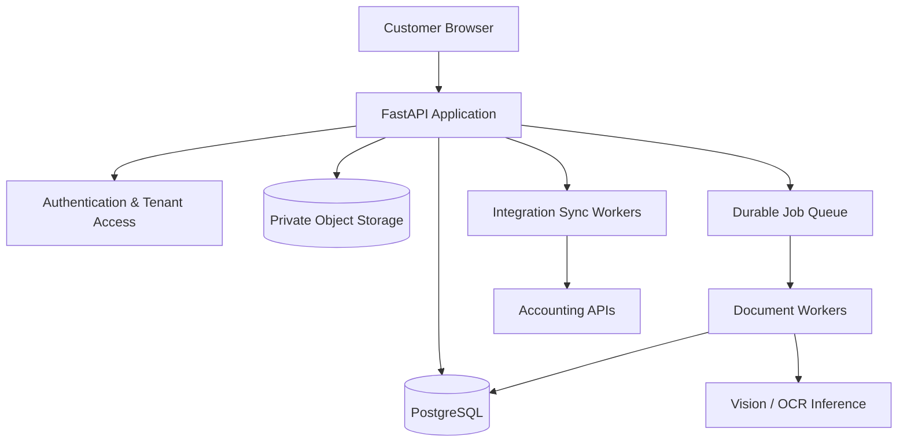

# InvoiceAI

Local-first invoice extraction and review PoC. It stores documents and invoice records locally, combines PDF text with page images for a local Ollama vision model, records evidence and extraction audit metadata, and only permits export and mock accounting synchronization after explicit human approval.

## Requirements

- Python 3.12+
- Node.js 20+
- Ollama installed locally

## Start Ollama

```bash
ollama pull qwen3-vl:8b
ollama serve
```

Configure the values in `.env.example` in the backend process environment. `OLLAMA_TIMEOUT` is bounded to 5–600 seconds, `OLLAMA_RETRIES` to 0–2, and `INVOICE_ROUNDING_TOLERANCE` defaults to EUR-style 0.02 monetary units. The server does not automatically load `.env`; export the values or use your preferred environment loader.

## Start the backend

```bash
cd backend
python3 -m venv .venv
source .venv/bin/activate
pip install -r requirements.txt
uvicorn app:app --reload --port 8000
```

The API docs are at http://localhost:8000/docs. SQLite and uploaded documents are created in `backend/data`.

## Start the frontend

In a second terminal:

```bash
cd frontend
npm install
npm run dev
```

Open http://localhost:5173. Vite forwards `/api` calls to the backend.

## Workflow

1. Upload a PDF, JPG, or PNG (up to 10 MB). Extraction runs in a FastAPI background task.
2. Open the invoice, compare the source and extracted JSON, and save corrections.
3. Run deterministic validation. Resolve errors, then explicitly approve.
4. Download canonical JSON or use **Sync Moneybird** to get a mock draft result. No document is sent to Moneybird.

The editor accepts the canonical invoice JSON. The schema and null behavior are visible in the API and extraction prompt. Invalid, unsupported, oversized, and extension/content-mismatched uploads are rejected.

The invoice API preserves its existing canonical `invoice` property and adds an `extraction` metadata property for provenance/evidence and correction history. Validation responses preserve `valid`, `errors`, and `warnings`, and add severity-coded `issues` plus a `review_assessment`. New read endpoints are `GET /api/invoices/{id}/audit` and `GET /api/benchmarks/latest`. Existing status and approval endpoints are unchanged.

## Tests

```bash
cd backend
pytest -q
```

Tests do not call Ollama or download a model. The PDF fixture is synthetic and its ground truth is hand-authored for that synthetic content.

## Extraction benchmarks

Run a real model benchmark with Ollama running and the configured vision model available:

```bash
cd backend
python -m scripts.evaluate_invoices --dataset tests/fixtures
```

The command writes measured output to `backend/tests/fixtures/results.json`; the Evaluation page reads that file. Delete it to return the dashboard to its empty state. Benchmark runs are separate from unit tests and can take time because they invoke the local model.

The current checked-in benchmark report is a real local Qwen3-VL run on the single synthetic fixture: 60% field accuracy, 0% whole-invoice exact match, 0% extraction failures, and about 110 seconds end-to-end processing. This one synthetic invoice is a pipeline smoke measurement only; it is not a representative accuracy estimate. The invoice correctly requires manual attention because currency and VAT/subtotal details were missed.

Add fixture documents under `backend/tests/fixtures/invoices/` and manually verified JSON with the same basename under `backend/tests/fixtures/ground_truth/`. Ground truth must be verified by a person; do not derive it from model output. `python scripts/create_synthetic_fixtures.py` recreates the included synthetic PDF.

Metric definitions:

- Per-field and overall accuracy are exact normalized matches, with a 0.01 numeric tolerance for money/rates/quantities; null matches only null. Line items are compared in document order, and VAT rows are compared in listed order.
- Whole-invoice exact match is the share of all dataset invoices with no incorrect scored field. Extraction failures count as non-matches.
- Extraction failure rate is failed model/document processing attempts divided by all fixtures.
- Average and p95 processing time measure successful document preprocessing plus model extraction, excluding failed calls.
- Critical false-accept rate is critical supplier/number/total mismatches among successfully extracted invoices that pass deterministic validation. It is null if there are no such accepted invoices.
- Validation-failure and manual-review rates use successful extractions as the denominator. Review includes validation warnings/errors or missing source evidence.
- Null accuracy is shown as unavailable when no ground-truth row scores a field; there is no production metric until a benchmark has been run.

## Architecture

See [ARCHITECTURE.md](ARCHITECTURE.md) for processing, validation, persistence, and accounting boundaries.

### Future Production Architecture (Planned)

The following is a target direction, not the architecture currently implemented. InvoiceAI will evolve incrementally from its local SQLite and Ollama PoC. Production components may change as scalability, security, and operational requirements become clearer.



- **FastAPI:** REST API and application orchestration.
- **Authentication & Tenant Access:** Authentication, authorization, and tenant isolation.
- **PostgreSQL:** Persistent storage for invoices, users, metadata, and processing states.
- **Private Object Storage:** Secure storage of uploaded invoices and documents.
- **Durable Job Queue:** Reliable asynchronous document processing, retries, and recovery.
- **Document Workers:** PDF preprocessing, OCR, AI extraction, and validation.
- **Vision / OCR Inference:** AI models responsible for extracting structured invoice data.
- **Integration Sync Workers:** Reliable synchronization with external accounting platforms.
- **Accounting APIs:** Moneybird, Exact Online, Xero, QuickBooks, and future integrations.

The current PoC continues to use SQLite, local document storage, FastAPI background tasks, and local Ollama/Qwen3-VL inference. Authentication, tenant isolation, PostgreSQL, private object storage, durable queues, and integration workers are planned and are not currently implemented.

## Current PoC limits

- The mock Moneybird adapter does not make live API calls. Live synchronization must wait for verified official API documentation and credentials.
- The UI uses a JSON editor for flexible field correction rather than schema-specific form controls.
- PDF preview uses the browser's built-in viewer; multi-page navigation and zoom are available there.
- FastAPI background tasks are process-local. Interrupted processing is marked failed on restart; retry currently requires a new upload. Replace this with a durable queue before multi-user or production use.
- Source evidence and coordinates are available only when the extracted value matches embedded PDF text. Scanned pages have no fabricated OCR quotes or bounding boxes and are marked for human review.
- The benchmark set currently contains one synthetic invoice and cannot support claims about general extraction accuracy. A real benchmark requires Ollama and a larger manually verified, anonymized dataset.
- A single SQLite database and local file storage are intended for one local user, not concurrent deployments.
- Extraction depends on a running Ollama server and downloaded vision model; the application reports connection/inference errors as failed records.
