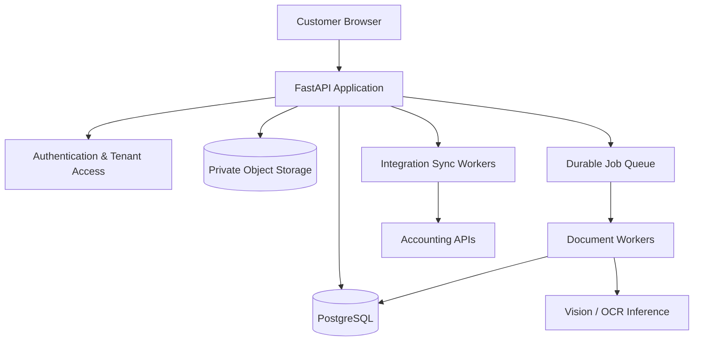

<div align="center">
  
  <br><br>
  <a href="https://github.com/AlexandrosMor/invoice-ai/actions/workflows/ci.yml">
    
  </a>
  <br><br>
  <strong>Local-first invoice processing, with a human in control.</strong><br>
  <sub>Extract · review · validate · export — with AI running on your machine.</sub>
</div>

## ✨ What’s included

- 🧠 **Local AI extraction** with Qwen3-VL through Ollama; no paid AI API required.
- 📄 **PDF and image uploads** with multi-page PDF preview and extraction status updates.
- 🔐 **Accounts and private workspaces** with user-scoped invoices, secure sessions, and profile management.
- 🧾 **Structured invoice review** for supplier details, VAT rows, line items, and totals, plus an Advanced JSON view.
- ✅ **Deterministic validation and human approval** before export or synchronization.
- 📦 **Canonical JSON export** and a clearly labeled mock Moneybird workflow.
- ⏱️ **Processing timing details** and benchmark tools to measure local extraction runs.

> InvoiceAI is an actively evolving local PoC. Real accounting connectors and production deployment infrastructure are not implemented yet.

## ⚙️ Requirements

- Python 3.12+
- Node.js 20+
- Ollama installed locally

## 🤝 Contributing and CI

Make changes on a feature branch and open a pull request targeting `main`; avoid pushing changes directly to `main`. The GitHub Actions **CI** workflow runs on pull requests to `main` and on pushes to `main`. It runs the backend test suite and builds the frontend. Resolve CI failures before merging, and use the pull request template to summarize the change and its verification.

The local equivalents are:

```bash
cd backend && pytest -q
cd ../frontend && npm ci && npm run build
```

## 🧠 Start Ollama

```bash
ollama pull qwen3-vl:8b
ollama serve
```

Configure the values in `.env.example` in the backend process environment. The default Ollama timeout is 600 seconds and automatic retries are disabled to avoid repeating long local inference calls; `OLLAMA_TIMEOUT` is bounded to 5–600 seconds and `OLLAMA_RETRIES` to 0–2. `INVOICE_ROUNDING_TOLERANCE` defaults to EUR-style 0.02 monetary units. The server does not automatically load `.env`; export the values or use your preferred environment loader, then restart the backend.

## 🐍 Start the backend

```bash
cd backend
python3 -m venv .venv
source .venv/bin/activate
pip install -r requirements.txt
./start.sh
```

The backend startup script sets a 600-second Ollama timeout and disables automatic retries by default. Override either value in the environment when needed, for example `OLLAMA_TIMEOUT=300 ./start.sh`. Set `PORT` to change the backend port.

The API docs are at http://localhost:8000/docs. SQLite and uploaded documents are created in `backend/data`. Registration is open in this local PoC; there is no email verification, password reset, account administration, or production-grade distributed rate limiter yet.

## ⚛️ Start the frontend

In a second terminal:

```bash
cd frontend
npm install
npm run dev
```

Open http://localhost:5173. Vite forwards `/api` calls to the backend.

## 🔄 Invoice workflow

1. Create an account or sign in. Email syntax is checked, but email ownership is not verified in this PoC.
2. Upload a PDF, JPG, or PNG (up to 10 MB). Extraction runs in a FastAPI background task.
3. Open the invoice, compare the source and extracted fields, and save corrections.
4. Run deterministic validation. Resolve errors, then explicitly approve.
5. Download canonical JSON or use **Sync Moneybird** to get a mock draft result. No document is sent to Moneybird.

## 🔌 Developer API

Create a scoped API key from **My Profile → API Keys**, then send it as a Bearer token. For local development:

```bash
export INVOICEAI_API_KEY="YOUR_API_KEY"
curl -X POST http://localhost:8000/api/v1/invoices \
  -H "Authorization: Bearer $INVOICEAI_API_KEY" \
  -F "file=@invoice.pdf"
```

The upload returns `202 Accepted` and an invoice ID while local extraction continues. Use `GET /api/v1/invoices/{id}` to check status, then `GET /api/v1/invoices/{id}/json` after processing completes. API keys only access the invoices and scopes of their owner. Use HTTPS outside local development.

See [docs/API.md](docs/API.md) for scopes, endpoints, pagination, errors, rate limits, and a polling example.

Invoices are scoped to the signed-in account. The browser uses an HttpOnly session cookie, a readable CSRF token cookie/header pair, and same-site cookie settings. Sessions expire after 14 days. Passwords are hashed with Argon2id; authentication attempts are rate-limited in process memory. Set `COOKIE_SECURE=true` behind HTTPS. For a different frontend origin, set `FRONTEND_ORIGIN` for the backend.

### 🗃️ Existing SQLite data

On startup, the app adds the ownership column without deleting existing invoices. Existing rows remain unassigned and are invisible to user accounts until an administrator explicitly assigns them. Create the destination account through the registration page, then review the dry-run list and assign only if appropriate:

```bash
cd backend
python scripts/assign_legacy_invoices.py --email owner@example.com
python scripts/assign_legacy_invoices.py --email owner@example.com --confirm
```

The command only assigns rows with no owner. Back up `backend/data/invoices.db` and the documents folder before performing the assignment.

The editor accepts the canonical invoice JSON. The schema and null behavior are visible in the API and extraction prompt. Invalid, unsupported, oversized, and extension/content-mismatched uploads are rejected.

The invoice API preserves its existing canonical `invoice` property and adds an `extraction` metadata property for provenance/evidence and correction history. Validation responses preserve `valid`, `errors`, and `warnings`, and add severity-coded `issues` plus a `review_assessment`. New read endpoints are `GET /api/invoices/{id}/audit` and `GET /api/benchmarks/latest`. Existing status and approval endpoints are unchanged.

## 🧪 Tests

```bash
cd backend
pytest -q
```

Tests do not call Ollama or download a model. The PDF fixture is synthetic and its ground truth is hand-authored for that synthetic content. GitHub Actions runs this backend suite together with the frontend production build for pull requests to `main`.

## 📊 Extraction benchmarks

Run a real model benchmark with Ollama running and the configured vision model available:

```bash
cd backend
python -m scripts.evaluate_invoices --dataset tests/fixtures
```

The command writes measured output to `backend/tests/fixtures/results.json`; the Evaluation page reads that file. Delete it to return the dashboard to its empty state. Benchmark runs are separate from unit tests and can take time because they invoke the local model.

The current checked-in benchmark report is a real local Qwen3-VL run on the single synthetic fixture: 60% field accuracy, 0% whole-invoice exact match, 0% extraction failures, 31 ms preprocessing, 137.1 seconds model inference, and 137.1 seconds end-to-end processing. This one synthetic invoice is a pipeline smoke measurement only; it is not a representative accuracy estimate. The invoice correctly requires manual attention because currency and VAT/subtotal details were missed. Compared with the previous recorded run (~110 seconds), this run took longer and field accuracy was unchanged; one sample cannot establish a performance trend.

Add fixture documents under `backend/tests/fixtures/invoices/` and manually verified JSON with the same basename under `backend/tests/fixtures/ground_truth/`. Ground truth must be verified by a person; do not derive it from model output. `python scripts/create_synthetic_fixtures.py` recreates the included synthetic PDF.

Metric definitions:

- Per-field and overall accuracy are exact normalized matches, with a 0.01 numeric tolerance for money/rates/quantities; null matches only null. Line items are compared in document order, and VAT rows are compared in listed order.
- Whole-invoice exact match is the share of all dataset invoices with no incorrect scored field. Extraction failures count as non-matches.
- Extraction failure rate is failed model/document processing attempts divided by all fixtures.
- Average preprocessing, average model inference, and average/p95 total processing time measure successful calls, excluding failures. Preprocessing and inference are reported separately to show where time is spent.
- Critical false-accept rate is critical supplier/number/total mismatches among successfully extracted invoices that pass deterministic validation. It is null if there are no such accepted invoices.
- Validation-failure and manual-review rates use successful extractions as the denominator. Review includes validation warnings/errors or missing source evidence.
- Null accuracy is shown as unavailable when no ground-truth row scores a field; there is no production metric until a benchmark has been run.

## 🏗️ Architecture

See [ARCHITECTURE.md](ARCHITECTURE.md) for processing, validation, persistence, and accounting boundaries.

### 🗺️ Future production architecture (planned)

The following is a target direction, not the architecture currently implemented. InvoiceAI will evolve incrementally from its local SQLite and Ollama PoC. Production components may change as scalability, security, and operational requirements become clearer.



- **FastAPI:** REST API and application orchestration.
- **Authentication & Tenant Access:** Authentication, authorization, and tenant isolation.
- **PostgreSQL:** Persistent storage for invoices, users, metadata, and processing states.
- **Private Object Storage:** Secure storage of uploaded invoices and documents.
- **Durable Job Queue:** Reliable asynchronous document processing, retries, and recovery.
- **Document Workers:** PDF preprocessing, OCR, AI extraction, and validation.
- **Vision / OCR Inference:** AI models responsible for extracting structured invoice data.
- **Integration Sync Workers:** Reliable synchronization with external accounting platforms.
- **Accounting APIs:** Moneybird, Exact Online, Xero, QuickBooks, and future integrations.

The current PoC uses SQLite, local document storage, FastAPI background tasks, local Ollama/Qwen3-VL inference, and a basic account/session layer with per-user invoice ownership. It does not implement PostgreSQL, private object storage, durable queues, or integration workers. InvoiceAI will move incrementally toward the planned architecture; components may change as scalability, security, and operational requirements become clearer.

## ℹ️ Current PoC limits

- The mock Moneybird adapter does not make live API calls. Live synchronization must wait for verified official API documentation and credentials.
- The UI provides structured invoice fields and an advanced JSON view for flexible correction.
- PDF preview uses the browser's built-in viewer; multi-page navigation and zoom are available there.
- FastAPI background tasks are process-local. Interrupted processing is marked failed on restart; retry currently requires a new upload. Replace this with a durable queue before multi-user or production use.
- Source evidence and coordinates are available only when the extracted value matches embedded PDF text. Scanned pages have no fabricated OCR quotes or bounding boxes and are marked for human review.
- The benchmark set currently contains one synthetic invoice and cannot support claims about general extraction accuracy. A real benchmark requires Ollama and a larger manually verified, anonymized dataset.
- The current account/session foundation uses a single SQLite database and local file storage. It is intended for a local PoC, not a concurrent or production deployment.
- Session rate limiting is in-memory and resets when the process restarts. Use a shared limiter and operational controls before deploying multiple workers.
- Registration does not verify email ownership, and account recovery is not implemented. Do not use it as a production identity system.
- Extraction depends on a running Ollama server and downloaded vision model; the application reports connection/inference errors as failed records.
