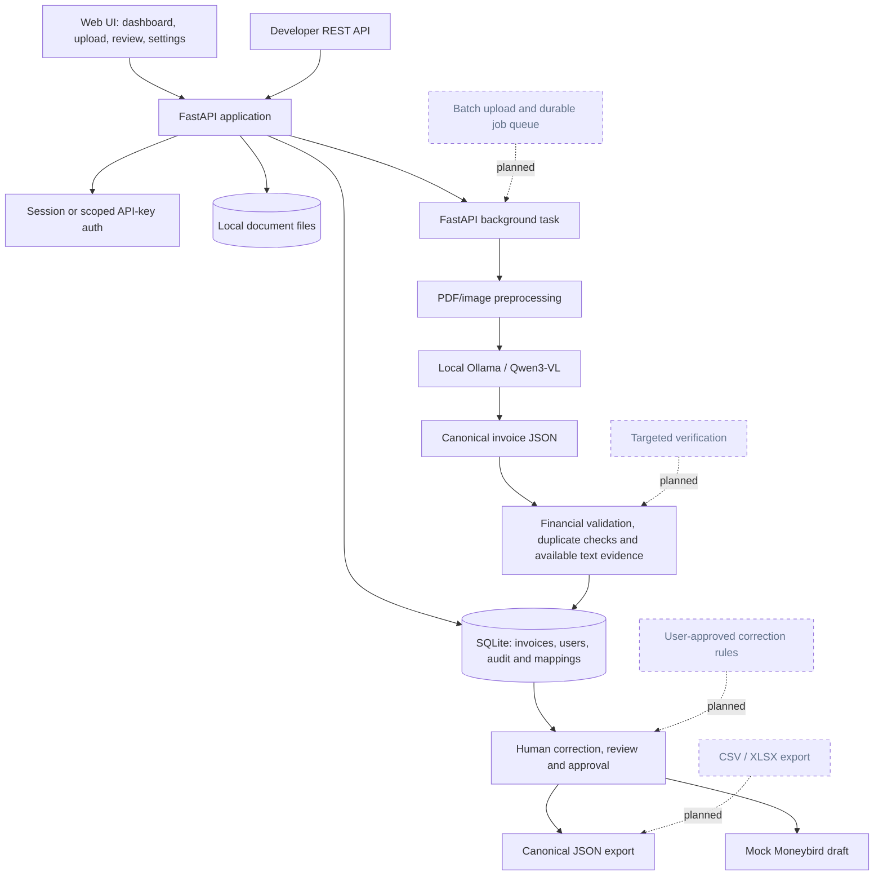

<div align="center">
  
  <br><br>
  <a href="https://github.com/AlexandrosMor/invoice-ai/actions/workflows/ci.yml">
    
  </a>
  <br><br>
  <strong>Local-first invoice processing, with a human in control.</strong><br>
  <sub>Extract · review · validate · export — with AI running on your machine.</sub>
</div>

## ✨ What’s included

- 🧠 **Pluggable local extraction** with the backwards-compatible Qwen3-VL/Ollama strategy, a conservative embedded-text baseline, and an opt-in hybrid selector.
- 📄 **PDF and image uploads** with multi-page document preview and background extraction status updates.
- 🟢 **Ollama readiness checks** that show whether the local service and configured model are available while an invoice is processing.
- 🔐 **Accounts and private workspaces** with user-scoped invoices, secure sessions, profile management, and API key creation/revocation.
- 🧾 **Human invoice review** with editable fields, text-derived source evidence where available, an audit trail, and an Advanced JSON view.
- ✅ **Deterministic financial validation** for line arithmetic, discounts, fees, VAT breakdowns and treatments, credit notes, and currency precision.
- 🔎 **Workspace-scoped duplicate checks** for identical files, invoice identity, and possible matches, with a reasoned override for warnings.
- 🧮 **Configurable accounting mappings** for supplier and description rules, GL categories/accounts, tax codes, and provider IDs; suggestions remain unconfirmed until reviewed.
- ✅ **Explicit approval** before canonical JSON export or accounting preparation.
- 🔌 **Scoped developer REST API** for asynchronous uploads, status and invoice reads, canonical JSON, and original document downloads.
- 📦 **Mock Moneybird workflow** that prepares a draft only when mappings are confirmed and external IDs are configured; it makes no live provider calls.
- 📊 **Dashboard, invoice history, and evaluation view** with extraction timing and local benchmark support.

> InvoiceAI is an actively evolving local PoC. Real accounting connectors and production deployment infrastructure are not implemented yet.

## ⚙️ Requirements

- Python 3.12+
- Node.js 20+
- Ollama installed locally

## 🤝 Contributing and CI

Make changes on a feature branch and open a pull request targeting `main`; avoid pushing changes directly to `main`. The GitHub Actions **CI** workflow runs on every branch push and on pull requests targeting `main`. It runs the backend test suite and builds the frontend. Resolve CI failures before merging, and use the pull request template to summarize the change and its verification.

The local equivalents are:

```bash
cd backend && pytest -q
cd ../frontend && npm ci && npm run build
```

## 🧠 Start Ollama

```bash
ollama pull qwen3-vl:8b
ollama serve
```

Configure the values in `.env.example` in the backend process environment. Set `INVOICE_EXTRACTION_STRATEGY` to `ollama` (default), `deterministic`, or `hybrid`. The hybrid strategy uses the deterministic text parser only when required fields have embedded-text evidence and deterministic validation is ready for review; otherwise it falls back to Ollama. It does not OCR scanned pages or use supplier templates yet. The default Ollama timeout is 600 seconds and automatic retries are disabled to avoid repeating long local inference calls; `OLLAMA_TIMEOUT` is bounded to 5–600 seconds and `OLLAMA_RETRIES` to 0–2. Without `INVOICE_ROUNDING_TOLERANCE`, validation uses currency precision defaults: 0.02 for two-decimal currencies, 0.002 for three-decimal currencies, and 1 unit for zero-decimal currencies. Set the variable to override that tolerance. The server does not automatically load `.env`; export the values or use your preferred environment loader, then restart the backend.

## 🐍 Start the backend

```bash
cd backend
python3 -m venv .venv
source .venv/bin/activate
pip install -r requirements.txt
./start.sh
```

The backend startup script sets a 600-second Ollama timeout and disables automatic retries by default. Override either value in the environment when needed, for example `OLLAMA_TIMEOUT=300 ./start.sh`. Set `PORT` to change the backend port.

The API docs are at http://localhost:8000/docs. SQLite and uploaded documents are created in `backend/data`. Registration is open in this local PoC; there is no email verification, password reset, account administration, or production-grade distributed rate limiter yet.

## ⚛️ Start the frontend

In a second terminal:

```bash
cd frontend
npm install
npm run dev
```

Open http://localhost:5173. Vite forwards `/api` calls to the backend.

Check whether the backend can reach Ollama and whether the configured model is installed:

```bash
curl http://localhost:8000/api/health
```

The response includes `ollama_available`, `model`, and `model_available`. The invoice review screen also checks and displays this status during processing.

## 🔄 Invoice workflow

1. Create an account or sign in. Email syntax is checked, but email ownership is not verified in this PoC.
2. Upload a PDF, JPG, or PNG (up to 10 MB). Extraction runs in a FastAPI background task; the review screen shows elapsed time and local Ollama/model readiness.
3. Review supplier and customer details, invoice dates, VAT rows, line items, and totals. Compare available source evidence, edit fields or JSON, and save corrections.
4. Run deterministic validation. Resolve errors and review warnings, then explicitly approve.
5. Review duplicate matches and accounting suggestions. Configure GL accounts, tax codes, supplier references, and mapping rules in **Settings**; confirm line mappings before sync.
6. Download canonical JSON or use **Sync Moneybird** for a mock draft. The mock requires configured GL and tax external IDs; no document is sent to Moneybird.

Use **Invoice History** to search workspace invoices, **Evaluation** to inspect benchmark results, and **My Profile** to update account details or manage scoped API keys.

## 🔌 Developer API

Create a scoped API key from **My Profile → API Keys**, then send it as a Bearer token. For local development:

```bash
export INVOICEAI_API_KEY="YOUR_API_KEY"
curl -X POST http://localhost:8000/api/v1/invoices \
  -H "Authorization: Bearer $INVOICEAI_API_KEY" \
  -F "file=@invoice.pdf"
```

The upload returns `202 Accepted` and an invoice ID while local extraction continues. Use `GET /api/v1/invoices/{id}` to check status and the selected extraction strategy, then `GET /api/v1/invoices/{id}/json` after processing completes. The API also supports cursor-paginated invoice listing and original document download with the `invoices:document:read` scope. API keys only access the invoices and scopes of their owner. Use HTTPS outside local development.

See [docs/API.md](docs/API.md) for scopes, endpoints, pagination, errors, rate limits, and a polling example.

Invoices are scoped to the signed-in account. The browser uses an HttpOnly session cookie, a readable CSRF token cookie/header pair, and same-site cookie settings. Sessions expire after 14 days. Passwords are hashed with Argon2id; authentication attempts are rate-limited in process memory. Set `COOKIE_SECURE=true` behind HTTPS. For a different frontend origin, set `FRONTEND_ORIGIN` for the backend.

### 🗃️ Existing SQLite data

On startup, the app adds the ownership column without deleting existing invoices. Existing rows remain unassigned and are invisible to user accounts until an administrator explicitly assigns them. Create the destination account through the registration page, then review the dry-run list and assign only if appropriate:

```bash
cd backend
python scripts/assign_legacy_invoices.py --email owner@example.com
python scripts/assign_legacy_invoices.py --email owner@example.com --confirm
```

The command only assigns rows with no owner. Back up `backend/data/invoices.db` and the documents folder before performing the assignment.

The editor accepts the canonical invoice JSON. The schema and null behavior are visible in the API and extraction prompt. Invalid, unsupported, oversized, and extension/content-mismatched uploads are rejected.

The invoice API preserves its existing canonical `invoice` property and adds an `extraction` metadata property for provenance/evidence and correction history. Validation responses preserve `valid`, `errors`, and `warnings`, and add severity-coded `issues` plus a `review_assessment`. New read endpoints are `GET /api/invoices/{id}/audit` and `GET /api/benchmarks/latest`. Existing status and approval endpoints are unchanged.

Duplicate details are available at `GET /api/invoices/{id}/duplicates`; suspected matches can be overridden with a recorded reason. Exact document duplicates are rejected within the same user workspace, with a unique SQLite index protecting concurrent uploads. Confirmed invoice identity duplicates block approval.

Accounting configuration is user-scoped: manage accounts at `/api/accounting/gl-accounts`, tax codes at `/api/accounting/tax-codes`, rules at `/api/accounting/mapping-rules`, and external supplier references at `/api/accounting/suppliers`. Invoice suggestions and explicit selections live separately from canonical extracted data at `/api/invoices/{id}/accounting-mapping`. SQLite schema changes are additive and preserve existing invoice rows and documents.

## 🧪 Tests

```bash
cd backend
pytest -q
```

Tests do not call Ollama or download a model. The PDF fixture is synthetic and its ground truth is hand-authored for that synthetic content. GitHub Actions runs this backend suite together with the frontend production build for pull requests to `main`.

## 📊 Extraction benchmarks

Generate or refresh the manually labeled core scenario set (Dutch 21% and 9%, multiple rates, zero-rate, reverse charge, credit note, multi-page table, discount, shipping, gross prices, invoice identity duplicate, exact-file re-upload):

```bash
cd backend
python scripts/create_core_fixtures.py
```

Run one strategy against a labeled dataset. Keep private invoices and reports outside the repository:

```bash
cd backend
python -m scripts.evaluate_invoices --dataset tests/fixtures/core --strategy deterministic --output /tmp/invoiceai-deterministic.json
```

Compare strategies on the same dataset (the Ollama and hybrid strategies require the configured local model):

```bash
python -m scripts.compare_extraction_strategies \
  --dataset tests/fixtures/core \
  --output-dir /tmp/invoiceai-strategy-comparison \
  --strategies deterministic,ollama,hybrid
```

The single-strategy command writes a report to the selected output path. The comparison command writes one detailed report per strategy and a summary `comparison.json`. To populate the Evaluation page, save a report to `backend/tests/fixtures/core/results.json`; it prefers that file, then falls back to `backend/tests/fixtures/results.json`. Delete the generated core report to return the dashboard to its checked-in fallback. Benchmark runs are separate from unit tests and can take time because they invoke the local model. Each invoice can wait up to the configured Ollama timeout (600 seconds by default), so slow or stalled local inference can make a full run take a long time.

The checked-in report under `tests/fixtures/results.json` is a real local Qwen3-VL run on the original single synthetic fixture: 60% field accuracy and 0% whole-invoice exact match. It is a pipeline smoke measurement, not a representative accuracy estimate. A local deterministic-parser run on the 13 synthetic core fixtures measured 99.1% field accuracy, 92.3% whole-invoice exact match, 100% line-item accuracy, 0% critical false acceptance, 30.8% manual review, and 28.9/49.3 ms p50/p95 processing. These fixtures are purpose-built and do not establish real-world performance. Qwen3-VL and hybrid have not yet been compared on this same core dataset; see [benchmark methodology and baseline](docs/EXTRACTION_BENCHMARKS.md). Duplicate metrics are also synthetic, and mapping suggestion accuracy remains unavailable until labeled mapping examples exist.

Add fixture documents under `backend/tests/fixtures/invoices/` and manually verified JSON with the same basename under `backend/tests/fixtures/ground_truth/`. Ground truth must be verified by a person; do not derive it from model output. `python scripts/create_synthetic_fixtures.py` recreates the included synthetic PDF.

Metric definitions:

- Per-field and overall accuracy are exact normalized matches, with a 0.01 numeric tolerance for money/rates/quantities; null matches only null. Line items are compared in document order, and VAT rows are compared in listed order.
- Whole-invoice exact match is the share of all dataset invoices with no incorrect scored field. Extraction failures count as non-matches.
- Extraction failure rate is failed model/document processing attempts divided by all fixtures.
- Average preprocessing, average model inference, and average/p95 total processing time measure successful calls, excluding failures. Preprocessing and inference are reported separately to show where time is spent.
- Critical false-accept rate is critical supplier/number/total mismatches among successfully extracted invoices that pass deterministic validation. It is null if there are no such accepted invoices.
- Validation-failure and manual-review rates use successful extractions as the denominator. Review includes validation warnings/errors or missing source evidence.
- Null accuracy is shown as unavailable when no ground-truth row scores a field; there is no production metric until a benchmark has been run.
- Duplicate precision/recall uses labeled duplicate cases in the benchmark dataset. Mapping suggestion correctness is explicitly unavailable until labeled mapping examples are provided.

## 🏗️ Architecture

See [ARCHITECTURE.md](ARCHITECTURE.md) for processing, validation, persistence, and accounting boundaries.

### Current application flow

This diagram describes the implementation in this repository. Uploads from the browser and developer API use the same invoice extraction path.



The application currently uses SQLite and local file storage, FastAPI background tasks, and local Ollama/Qwen3-VL inference. Text evidence is available only when extracted values match embedded PDF text; scanned-image OCR evidence is not currently produced. Mapping decisions and audit events are stored separately from canonical invoice facts. The Moneybird adapter creates a local mock response and does not call an external service.

### 🗺️ Planned capabilities

The following items are goals from the next development phase and are not implemented in the current application:

- Evidence-based field verification with targeted independent rechecks and field-level conflict states.
- Explicitly approved reusable correction rules; the current audit trail records changes but does not learn or apply correction rules.
- Multi-file batch upload, batch management, and a persistent SQLite-backed job queue with restart recovery. Current processing uses process-local FastAPI background tasks, so interrupted work is not durable.
- CSV and XLSX exports. The current structured export is canonical JSON; invoice accounting synchronization is mock-only.

The longer-term production architecture may replace SQLite, local file storage, and process-local tasks with PostgreSQL, private object storage, and durable workers after scaling and operational requirements are established.

## ℹ️ Current PoC limits

- The mock Moneybird adapter does not make live API calls. Live synchronization must wait for verified official API documentation and credentials.
- Accounting rules and codes are configurable per user, but organization-wide sharing, provider catalog import, and automated account-code recommendations are not implemented. VAT classification requires explicit user context or a matching user rule.
- The UI provides structured invoice fields and an advanced JSON view for flexible correction.
- PDF preview uses the browser's built-in viewer; multi-page navigation and zoom are available there.
- FastAPI background tasks are process-local. Interrupted processing is marked failed on restart; retry currently requires a new upload. Replace this with a durable queue before multi-user or production use.
- Upload is currently one invoice per request. Batch upload, persistent jobs, and automated retry/recovery are planned; no worker service needs to be started separately in the current setup.
- There is no reusable correction-learning system, targeted second-pass verification engine, or CSV/XLSX export yet. Corrections are saved to the invoice and recorded in its audit history.
- Source evidence and coordinates are available only when the extracted value matches embedded PDF text. Scanned pages have no fabricated OCR quotes or bounding boxes and are marked for human review.
- The core benchmark fixtures are synthetic and manually labeled. Their measured extraction metrics are not representative of real supplier documents; a commercial evaluation requires a larger, diverse, manually reviewed dataset.
- The current account/session foundation uses a single SQLite database and local file storage. It is intended for a local PoC, not a concurrent or production deployment.
- Session rate limiting is in-memory and resets when the process restarts. Use a shared limiter and operational controls before deploying multiple workers.
- Registration does not verify email ownership, and account recovery is not implemented. Do not use it as a production identity system.
- Extraction depends on a running Ollama server and downloaded vision model; the application reports connection/inference errors as failed records.
